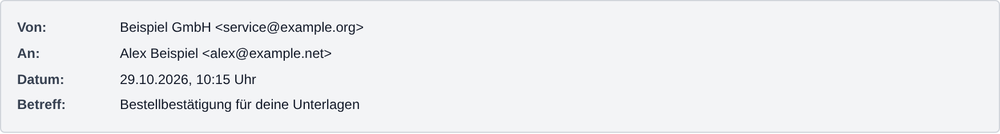

# Paperless-ngx Mail Header

A lightweight, unofficial **Paperless-ngx 3** parser extension that adds an email's **sender, recipient, date and subject** above its existing HTML content in the generated PDF. Everything else stays with Paperless-ngx's native mail parser.

> [!IMPORTANT]
> This is an independent community extension. It is not affiliated with, endorsed by, or officially supported by Paperless-ngx.



*Example generated from the actual header formatter with fictional addresses.*

## Features

- Inserts four localized rows: **Von**, **An**, **Datum** and **Betreff**.
- Shows the email's timestamp in **Europe/Berlin**, including daylight-saving time.
- Escapes header values before inserting HTML.
- Preserves the original HTML body without re-serializing it; native Paperless continues to render via Gotenberg.
- Leaves plain-text-only messages on the existing Paperless text-rendering path (which already includes mail headers).
- Leaves the original `.eml`, attachment filtering, OCR, PDF/A, Gotenberg handling, indexing and workflows unchanged.
- Uses the documented Paperless parser entry point, rather than modifying Paperless application files.

## Status and compatibility

| Component | State | Evidence |
| --- | --- | --- |
| Paperless-ngx `3.3.0` | **Real-stack verified with synthetic inputs** | `0.2.0`: 13 successful documents per native/plugin instance plus matching invalid-sender rejection; [report](docs/integration-report.md) |
| Paperless-ngx other 3.x releases | **Not verified** | Parser internals can change between versions |
| Unit test suite | **Unit tested** | 40 tests pass in CI on Python 3.12–3.14; unit tests use a native-parser double, with a separate real-stack integration workflow |
| Plain-text-only `.eml` | **Native fallback verified** | Real PDF text/page count match the native baseline |
| HTML with PDF attachments | **Native delegation** | Real EML and separate PDF uploads verified; IMAP mail-rule extraction is outside the integration scope |

Current public release: [`v0.2.0`](https://github.com/MarcLeinenDE/paperless-ngx-mail-header/releases/tag/v0.2.0). See the [integration report](docs/integration-report.md) for exact versions and test scope, and the [changelog](CHANGELOG.md) for release history.

## Installation

The extension is distributed as a Python wheel through this repository's [GitHub Releases](https://github.com/MarcLeinenDE/paperless-ngx-mail-header/releases).

### Requirements

- Paperless-ngx with parser-plugin support; verified on `3.3.0`.
- Python `3.12` or later in the environment running Paperless.
- A working native Paperless email-conversion setup with Gotenberg and Tika.

### Installing the wheel

1. Open the [latest stable release](https://github.com/MarcLeinenDE/paperless-ngx-mail-header/releases/latest).
2. Download the wheel and `SHA256SUMS.txt` from the same release. For `v0.2.0`, the wheel is `paperless_ngx_mail_header-0.2.0-py3-none-any.whl`.
3. Verify the wheel's SHA-256 against its entry in `SHA256SUMS.txt`.
4. Install the wheel with `--no-deps` in the **same Python environment used by Paperless**.
5. Restart the Paperless processes that load the parser registry, including the consumer, workers and webserver as applicable, then verify parser selection below.

For a uv-based LXC installation using `/opt/paperless/.venv`, an example is:

```bash
sha256sum paperless_ngx_mail_header-0.2.0-py3-none-any.whl
# Compare the complete hash with the wheel entry in SHA256SUMS.txt.
uv pip install --python /opt/paperless/.venv/bin/python --no-deps ./paperless_ngx_mail_header-0.2.0-py3-none-any.whl
```

Run this in the Paperless environment after transferring the wheel and checking the interpreter path. Docker deployments should install the wheel in a derived image so it survives container replacement. Back up before updating an existing installation and keep a rollback package available.

**Do not modify mail rules just to activate the plugin.** Installation affects future parsing; existing PDFs are not automatically regenerated.

Detailed instructions:

- [Installation — LXC / community-scripts and Docker](docs/installation.md)
- [Configuration and HTML layout](docs/configuration.md)
- [Updates and rollback](docs/installation.md#updates)
- [Troubleshooting](docs/troubleshooting.md)

### Verify the installation

After installing in the correct Python environment, Paperless should log something like:

```text
Loaded third-party parser 'Paperless-ngx Mail Header' ...
Document handled by third-party parser 'Paperless-ngx Mail Header' ...
```

The plugin handles only `message/rfc822`; it does not replace PDF, raster-image or office-document parsers.

## Development

```bash
python -m pip install -e '.[test]'
python -m pytest -q
python -m pip install build
python -m build
```

Tests use test doubles instead of a live Paperless installation. A separate real Paperless/Gotenberg/Tika workflow exercises synthetic end-to-end imports; see [Testing](docs/testing.md).

## Project layout

```text
src/paperless_ngx_mail_header/  Plugin entry point and HTML formatter
tests/                         Offline regression and real-stack integration tests
docs/                          Installation, configuration, privacy and test evidence
scripts/                       Package validation and synthetic-example generation
.github/workflows/             Test, package-build and real-stack integration CI
```

## Privacy and security

The extension does not independently call remote services. By default, Paperless itself may call Gotenberg or Tika according to its configuration. Loading remote images is controlled **separately by Gotenberg**; enabling that feature can fetch tracking pixels or attacker-controlled URLs. See [Privacy and security](docs/privacy-security.md).

Never commit real `.eml` messages, document scans, invoices, customer IDs or live mail addresses as test samples. The example image uses fictional values.

## Contributing

Contributions are welcome under the project's documented license policy. Keep the plugin intentionally small, write regression tests, and distinguish *unit tested* from *live verified*. Read [CONTRIBUTING.md](CONTRIBUTING.md) and [AGENTS.md](AGENTS.md).

## Licensing

- **Project-authored software:** GNU GPL-3.0-or-later (see [LICENSE](LICENSE)).
- **Project-authored documentation and example image:** CC BY-SA 4.0 (see [LICENSES.md](LICENSES.md) and [the canonical license text](https://creativecommons.org/licenses/by-sa/4.0/legalcode)).
- Third-party programs and dependencies keep their own copyright and licenses. See [THIRD_PARTY_NOTICES.md](THIRD_PARTY_NOTICES.md).

## Disclaimer and no warranty

Provided **AS IS**, without warranty. This plugin depends on Paperless internals and may need updates for future releases. It does not replace secure email handling or document-integrity controls. Product names and trademarks belong to their respective owners.

## Project background and maintainer availability

This project started as a private spare-time extension for my own Paperless installation. I wanted sender, recipient, date and subject to remain visible above the HTML content of archived emails while keeping Paperless's existing mail-processing paths. I decided to publish the resulting work so that other users can benefit from it instead of having to repeat the same work from scratch.

Issues, corrections and pull requests are welcome. This is not a commercial project and there is no support or response-time commitment. I have a young child and limited spare time, so reviews and replies may sometimes take a while. Community contributions are nevertheless very welcome.

Copyright © 2026 Marc Leinen and contributors.

---

### ☕ Like this project?

If this work saved you some time or a few developer nerves, you can [buy me a coffee via PayPal](https://www.paypal.me/ccaa/). ☕😄

No obligation — a ⭐, useful issue, or contribution is equally appreciated. See [SUPPORT.md](SUPPORT.md) for details.
